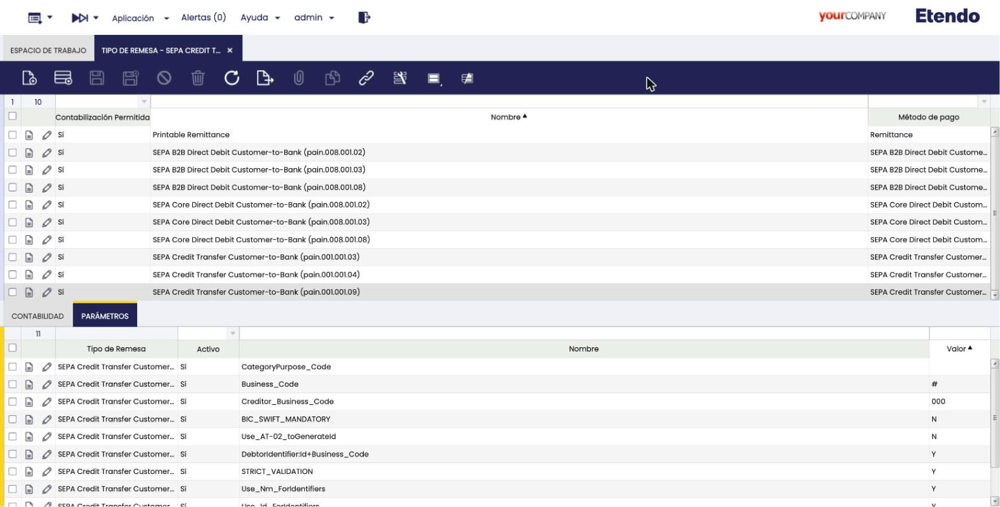
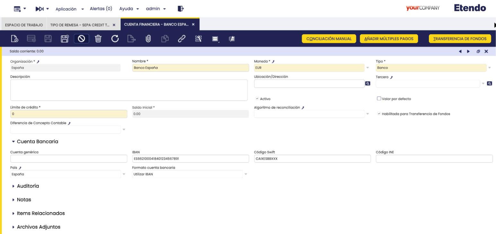
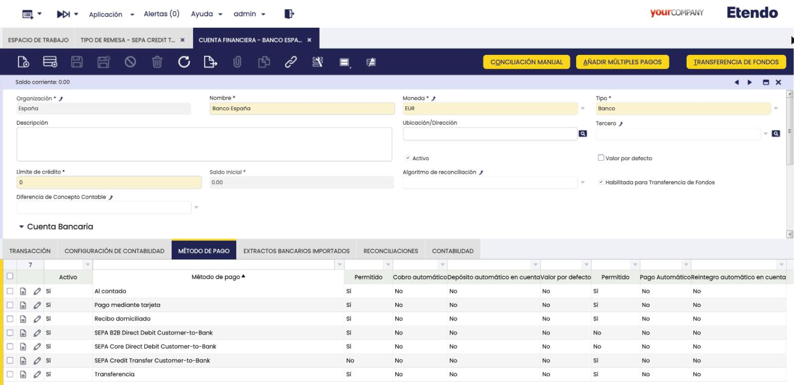
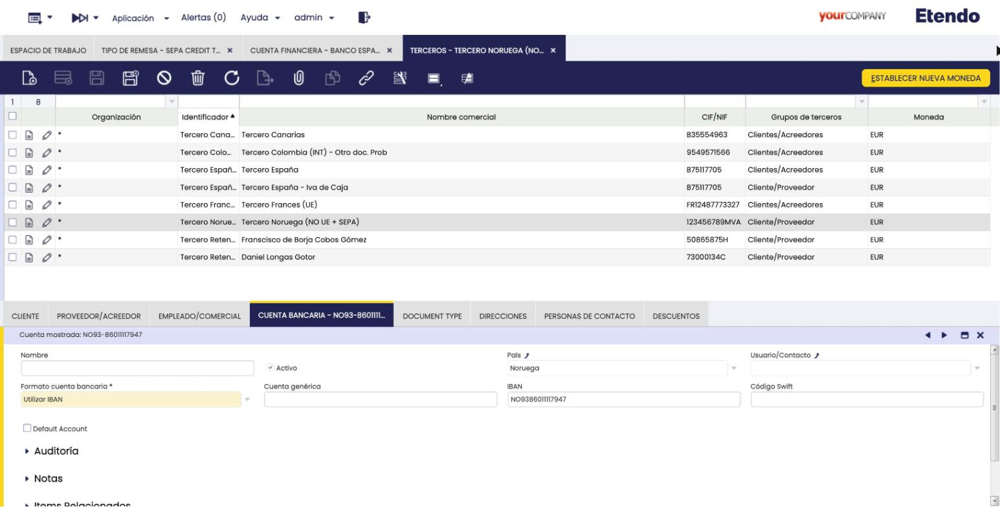
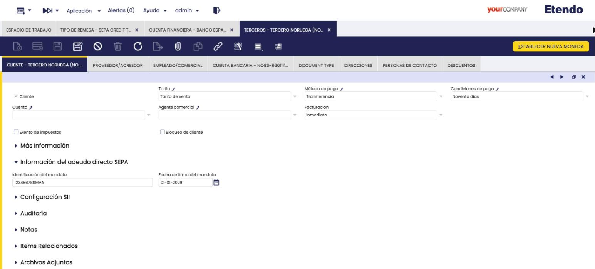
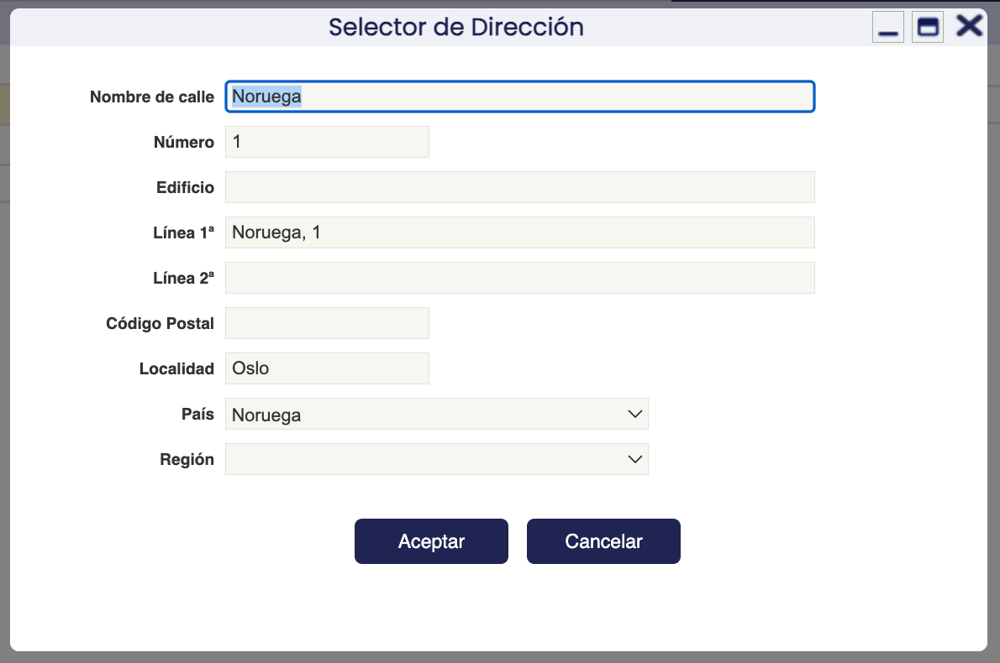
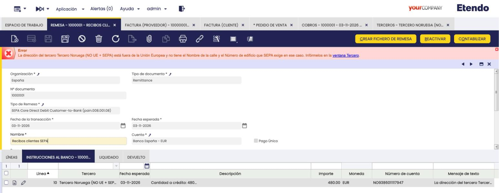
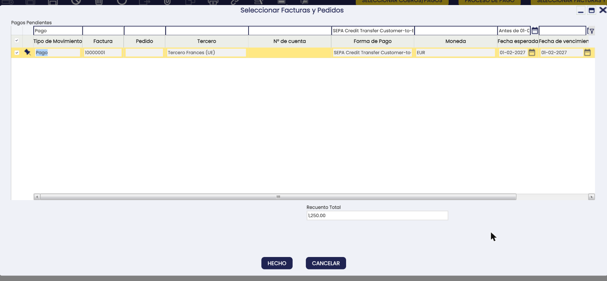
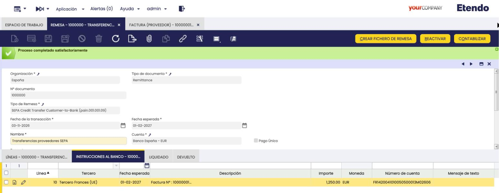
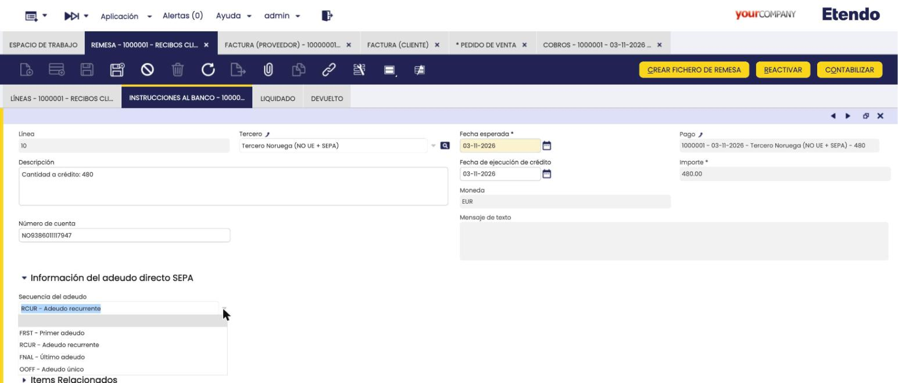

# SEPA { #sepa }

## Javapackages { #javapackages }

:octicons-package-16: Javapackage: `org.openbravo.sepa.iso20022`  
:octicons-package-16: Javapackage: `org.openbravo.sepa.iso20022.template`  
:octicons-package-16: Javapackage: `org.openbravo.sepa.iso20022.credittransfer.customertobank`  
:octicons-package-16: Javapackage: `org.openbravo.sepa.iso20022.coredirectdebit.customertobank`  
:octicons-package-16: Javapackage: `org.openbravo.sepa.iso20022.es_es`  
:octicons-package-16: Javapackage: `org.openbravo.sepa.iso20022.coredirectdebit.customertobank.es_es`

## Visión General { #overview }

SEPA (*Single Euro Payments Area*, Zona Única de Pagos en Euros) es el sistema europeo que unifica los pagos en euros entre los países adheridos. Desde febrero de 2014 es el esquema oficial tanto para transferencias como para adeudos directos (recibos domiciliados).

Las funcionalidades SEPA de Etendo permiten generar, a partir de una [Remesa](../../../basic-features/financial-management/receivables-and-payables/transactions/remittance.md), un fichero XML conforme al estándar **ISO 20022**, el formato que los bancos europeos utilizan para recibir órdenes de pago y de cobro. Las reglas de SEPA las define el **EPC** (*European Payments Council*, Consejo Europeo de Pagos). Etendo cubre dos casos de uso:

| Funcionalidad | Objetivo | Tipo de transacción | Esquema XML |
| --- | --- | --- | --- |
| **SEPA Credit Transfer** (Transferencia SEPA) | Pagar a proveedores, acreedores o empleados | Pagos (*Payment Out*) | `pain.001.001.03`, `pain.001.001.04`, `pain.001.001.09` |
| **SEPA Direct Debit** (Adeudo Directo SEPA, CORE y B2B) | Cobrar a clientes mediante recibos domiciliados | Cobros (*Payment In*) | `pain.008.001.02`, `pain.008.001.03`, `pain.008.001.08` |

!!! info
    Cada país y entidad bancaria puede admitir versiones de esquema distintas. Consulte con su banco qué versión utilizar.

    Las versiones `pain.001.001.09` (transferencias) y `pain.008.001.08` (adeudos directos) son las únicas que envían la dirección postal desglosada en calle, número y edificio (**dirección estructurada**), tal como exigen las normas del EPC. Para utilizarlas, complete antes la [dirección estructurada](#structured-address) de la organización y de los terceros.

### Módulos { #modules }

Los siguientes módulos se instalan con el Bundle de Localización Española. Esta lista es informativa.

- **SEPA Framework and Utilities** (`org.openbravo.sepa.iso20022`): base común de todos los módulos SEPA: genera y valida los ficheros para el banco. Añade a las direcciones los campos **Nombre de calle**, **Número** y **Edificio**, que se completan desde la ventana emergente **Selector de Dirección**. Su traducción al español es `org.openbravo.sepa.iso20022.es_es`.
- **SEPA Framework and Utilities Template** (`org.openbravo.sepa.iso20022.template`): al editar la dirección de un tercero o de la organización, la ventana emergente **Selector de Dirección** muestra los campos desglosados de la dirección SEPA.
- **SEPA Credit Transfer Customer-to-Bank** (`org.openbravo.sepa.iso20022.credittransfer.customertobank`): genera ficheros de transferencias SEPA para realizar pagos.
- **SEPA Direct Debit Customer-to-Bank** (`org.openbravo.sepa.iso20022.coredirectdebit.customertobank`): genera ficheros de adeudos directos SEPA (CORE y B2B) para realizar cobros. Su traducción al español es `org.openbravo.sepa.iso20022.coredirectdebit.customertobank.es_es`.

Además, los módulos SEPA dependen del módulo **European Union Countries**, que se utiliza para determinar si la dirección de un tercero está dentro o fuera de la Unión Europea.

### Relación con Remesas { #remittance-relationship }

Los módulos SEPA se basan en la infraestructura de [Remesas](../../../basic-features/financial-management/receivables-and-payables/transactions/remittance.md). Una remesa SEPA se gestiona igual que cualquier otra remesa: se crea, se añaden los pagos o cobros y se procesa. Solo cambian dos cosas: el tipo de remesa es uno de los tipos SEPA y, al final, Etendo genera el fichero para enviarlo al banco.

!!! info
    Antes de trabajar con SEPA, revise la documentación de [Tipo de Remesa](../../../basic-features/financial-management/receivables-and-payables/setup/remittance-type.md) y [Remesa](../../../basic-features/financial-management/receivables-and-payables/transactions/remittance.md). La funcionalidad de Remesas forma parte del [Financial Extensions Bundle](https://marketplace.etendo.cloud/#/product-details?module=9876ABEF90CC4ABABFC399544AC14558){target="_blank"}.

### SEPA Core y SEPA B2B { #core-and-b2b }

El adeudo directo SEPA se basa en el principio de solicitar dinero a un tercero, con su autorización previa (**mandato**), e ingresarlo en la cuenta propia. Existen dos esquemas:

- **SEPA Core Direct Debit**: esquema básico, aplicable tanto a particulares como a empresas. El deudor puede solicitar la devolución de un cargo autorizado.
- **SEPA B2B Direct Debit**: disponible únicamente cuando el deudor es una empresa. Sus principales diferencias son:
    - El deudor no tiene derecho a la devolución de una operación autorizada.
    - El banco del deudor debe verificar el cobro contra la información del mandato.
    - Los plazos de presentación y de devolución son más cortos.

## Configuración { #configuration }

### Aplicar el dataset { #apply-dataset }

:material-menu: `Aplicación` > `Configuración General` > `Organización` > `Gestión del módulo de Empresa`

Un *dataset* es un conjunto de datos de configuración inicial que se carga en la organización. Para que los métodos de pago y los tipos de remesa SEPA estén disponibles, aplique a la organización:

- El dataset **SEPA Credit Transfer Customer-to-Bank**, si va a realizar pagos.
- El dataset **SEPA Direct Debit Customer-to-Bank**, si va a realizar cobros.
- El dataset de **Remesas**, si no lo ha aplicado previamente.

!!! info
    Para más información, visite [Gestión del módulo de Empresa](../../../basic-features/general-setup/enterprise-model/enterprise-module-management.md).

Los datasets añaden:

| Dataset | Métodos de pago | Tipos de remesa |
| --- | --- | --- |
| SEPA Credit Transfer Customer-to-Bank | `SEPA Credit Transfer Customer-to-Bank` | `SEPA Credit Transfer Customer-to-Bank (pain.001.001.03)`, `(pain.001.001.04)` y `(pain.001.001.09)` |
| SEPA Direct Debit Customer-to-Bank | `SEPA Core Direct Debit Customer-to-Bank` y `SEPA B2B Direct Debit Customer-to-Bank` | `SEPA Core Direct Debit Customer-to-Bank` y `SEPA B2B Direct Debit Customer-to-Bank`, cada uno en las versiones `(pain.008.001.02)`, `(pain.008.001.03)` y `(pain.008.001.08)` |

Todos los tipos de remesa quedan asociados a su método de pago correspondiente y se crean con sus parámetros ya configurados, por lo que pueden utilizarse sin configuración manual adicional.

### Parámetros del Tipo de Remesa { #remittance-type-parameters }

:material-menu: `Aplicación` > `Gestión Financiera` > `Cobros y Pagos` > `Configuración` > `Tipo de Remesa`

Cada tipo de remesa SEPA incluye un conjunto de parámetros que definen cómo se genera el fichero XML. En general no es necesario modificarlos. Utilice la configuración por defecto y ajuste los parámetros solo si el banco rechaza el fichero o le indica otros requisitos.

<figure markdown="span">
  
  <figcaption>Tipos de remesa SEPA y parámetros del tipo de remesa <code>pain.001.001.09</code></figcaption>
</figure>

**Parámetros comunes (Transferencia y Adeudo Directo)**

| Parámetro | Valor por defecto | Descripción |
| --- | --- | --- |
| `STRICT_VALIDATION` | `Y` | Antes de generar el fichero, comprueba que cumple exactamente el formato oficial de la versión elegida. Así se detectan errores antes de enviarlo al banco (por ejemplo, un BIC incorrecto). Se recomienda mantenerlo en `Y`. |
| `Use_Nm_ForIdentifiers` | `Y` | Incluye en el fichero el nombre de la organización y de cada tercero junto a su identificación. Cámbielo a `N` solo si el banco indica que no lo admite. |
| `Use_Id_ForIdentifiers` | `Y` | Incluye en la identificación de la organización y de cada tercero un código basado en su NIF/CIF. Con `N`, el fichero no incluye ningún código de identificación y se ignora `Use_AT-02_toGenerateId`. |
| `Use_AT-02_toGenerateId` | `N` (Transferencia) / `Y` (Adeudo Directo) | Construye el código de identificación con el formato oficial de SEPA (regla AT-02 del EPC): código del país (2 letras) + 2 dígitos de control (Etendo los calcula) + código de negocio + NIF/CIF. Con `N`, el código de identificación es directamente el NIF/CIF. |
| `BIC_SWIFT_MANDATORY` | `Y` | Exige el código BIC (SWIFT) de la cuenta financiera y de las cuentas de los terceros. Si falta alguno, Etendo no genera el fichero e indica el problema. Cámbielo a `N` si el banco admite dejar el BIC en blanco. |
| `GENERATE_BUSINESSPARTNER_IBAN` | `N` | Genera el IBAN del tercero a partir del número de cuenta y del país de la cuenta bancaria o de la dirección del tercero. Las autoridades SEPA recomiendan solicitar el IBAN a los terceros en lugar de generarlo. |

**Parámetros específicos de SEPA Credit Transfer**

| Parámetro | Valor por defecto | Descripción |
| --- | --- | --- |
| `DebtorIdentifier:Id+Business_Code` | `N` | Algunos bancos requieren que la identificación del ordenante combine el NIF/CIF con un sufijo (código de negocio). En ese caso, cambie este parámetro y `Use_Id_ForIdentifiers` a `Y` e informe `Business_Code`. |
| `Business_Code` | `ZZZ` | Código de negocio que usan algunos bancos para identificar el contrato del ordenante. Se utiliza cuando `DebtorIdentifier:Id+Business_Code` o `Use_AT-02_toGenerateId` están en `Y`. |
| `GroupBy_Duedate` | `N` | Con `Y`, el fichero agrupa los pagos de la remesa por fecha de vencimiento, en un bloque por cada fecha. |
| `CategoryPurpose_Code` | (vacío) | Indica al banco la finalidad de los pagos de la remesa. Normalmente se deja vacío. En España se utiliza `SALA` para remesas de nóminas y `PENS` para remesas de pensiones. |

**Parámetros específicos de SEPA Direct Debit**

| Parámetro | Valor por defecto | Descripción |
| --- | --- | --- |
| `Include_InitiatingPartyId` | `Y` | Incluye en el fichero la identificación de la organización que crea la remesa. Algunos países no lo permiten; en ese caso, cámbielo a `N`. |
| `CORE_B2B` | Según el tipo de remesa | Esquema de adeudo directo: `CORE`, `B2B` o `COR1`. `COR1` se utiliza habitualmente en España para unificar y acortar los plazos de presentación. |
| `Creditor_Business_Code` | `ZZZ` | Código comercial del acreedor (número de 3 dígitos entre 000 y 999), que identifica los distintos contratos o servicios firmados con el banco. `ZZZ` indica que no se utiliza; normalmente debe dejarse así. |
| `SEPA_DD_Financed_58` | (vacío) | Permite generar remesas de adeudo directo **financiadas** (antiguo Cuaderno 58 en España). Para ello, cree un nuevo tipo de remesa SEPA Direct Debit con este parámetro en `FSDD`. El fichero se identifica entonces como remesa financiada (el identificador del mensaje incluye el prefijo `FSDD`). |

### Cuenta Financiera { #financial-account }

:material-menu: `Aplicación` > `Gestión Financiera` > `Cobros y Pagos` > `Transacciones` > `Cuenta Financiera`

**IBAN y BIC (código SWIFT)**

La cuenta financiera desde la que se envía la remesa debe tener informado el **IBAN** y el **BIC (código SWIFT)** del banco. Etendo valida automáticamente el formato del IBAN según el país del banco.

Esta información es obligatoria para generar el fichero SEPA. Si falta, Etendo no genera el fichero e indica el problema.

Si su banco no exige el BIC, cambie el parámetro `BIC_SWIFT_MANDATORY` a `N` en la ventana **Tipo de Remesa** (ver [Parámetros del Tipo de Remesa](#remittance-type-parameters)).

<figure markdown="span">
  
  <figcaption>Sección Cuenta Bancaria de la cuenta financiera con el IBAN y el código Swift</figcaption>
</figure>

**Método de pago**

En la solapa [Método de Pago](../../../basic-features/financial-management/receivables-and-payables/transactions/financial-account.md#payment-method) de la cuenta financiera, añada el método de pago SEPA correspondiente:

- `SEPA Credit Transfer Customer-to-Bank`, para pagos.
- `SEPA Core Direct Debit Customer-to-Bank` y/o `SEPA B2B Direct Debit Customer-to-Bank`, para cobros. Añada ambos si utiliza los dos esquemas en distintas remesas.

<figure markdown="span">
  
  <figcaption>Métodos de pago SEPA asociados a la cuenta financiera</figcaption>
</figure>

Estos métodos de pago tienen la siguiente configuración:

- Solo permiten pagos (*Payment Out*) en el caso de la transferencia, o solo cobros (*Payment In*) en el caso del adeudo directo.
- Ejecución **automática**, vinculada al proceso de ejecución `En Remesa` (*In Remittance*).
- Sin cuentas contables de recepción, depósito o conciliación, ya que las remesas tienen su propia contabilización, definida en las cuentas del [Tipo de Remesa](../../../basic-features/financial-management/receivables-and-payables/setup/remittance-type.md).

### Terceros { #business-partners }

:material-menu: `Aplicación` > `Gestión de Datos Maestros` > `Terceros`

**IBAN y BIC (código SWIFT)**

En la solapa [Cuenta bancaria](../../../basic-features/master-data-management/master-data/business-partner.md#bank-account) de cada tercero, informe:

- El **IBAN**, si en el campo **Formato cuenta bancaria** se selecciona `Utilizar IBAN`, o bien
- El **Nº de cuenta** genérico, si se selecciona `Usar nº de cuenta genérico` o `Usar SWIFT + nº de cuenta genérico`. En este caso, Etendo puede generar el IBAN automáticamente si el parámetro `GENERATE_BUSINESSPARTNER_IBAN` está en `Y`.

Informe también el **Código Swift** (BIC) del banco del tercero. Si no lo conoce y su banco no lo exige, cambie el parámetro `BIC_SWIFT_MANDATORY` a `N` en la ventana **Tipo de Remesa**.

Esta información es obligatoria para generar el fichero SEPA. Si falta, Etendo no genera el fichero e indica el problema.

<figure markdown="span">
  
  <figcaption>Cuenta bancaria de un tercero con formato <code>Utilizar IBAN</code></figcaption>
</figure>

**Información del mandato (solo Adeudo Directo)**

En la solapa [Cliente](../../../basic-features/master-data-management/master-data/business-partner.md#customer) del tercero, el grupo de campos **Información del adeudo directo SEPA** incluye:

- **Identificación del mandato**
- **Fecha de firma del mandato**

<figure markdown="span">
  
  <figcaption>Datos del mandato en la solapa Cliente del tercero</figcaption>
</figure>

Estos campos recogen la información del mandato firmado entre el deudor (cliente) y el acreedor que autoriza los adeudos SEPA. En España, las normas bancarias suelen exigir que esta información se incluya en el fichero. Por eso, informe estos campos en cada cliente al que envíe adeudos. Si no se informan, Etendo genera el fichero sin ellos.

### Dirección estructurada { #structured-address }

Las versiones de esquema `pain.001.001.09` y `pain.008.001.08` envían la dirección postal de la organización y de los terceros en formato estructurado, es decir, con la calle, el número, el edificio, el código postal, la localidad y el país en campos separados. Las versiones anteriores envían la dirección como texto libre.

Para informar estos datos, al editar la dirección de un tercero o de la organización, la ventana emergente **Selector de Dirección** muestra los siguientes campos adicionales:

| Campo | Longitud máxima | Obligatorio | Descripción |
| --- | --- | --- | --- |
| **Nombre de calle** | 70 caracteres | Según el caso (ver tabla siguiente) | Nombre de la calle, sin el número. |
| **Número** | 16 caracteres | Según el caso (ver tabla siguiente) | Número del edificio. |
| **Edificio** | 35 caracteres | No | Nombre del edificio. Solo se envía en el fichero si está informado. |

<figure markdown="span">
  
  <figcaption>Ventana Selector de Dirección con los campos de la dirección estructurada</figcaption>
</figure>

Al aceptar la dirección, Etendo completa automáticamente las líneas de dirección **Línea 1ª** y **Línea 2ª** con los datos estructurados (por ejemplo, `Nombre de calle, Número - Edificio`), ya que otros informes y procesos siguen leyendo la dirección desde esas líneas. Si lo que se informa no cabe en una línea (60 caracteres), se pasa a la segunda línea sin cortar ningún campo. Las direcciones existentes que no tienen informado el Nombre de calle conservan sus líneas de dirección actuales.

Al generar el fichero con las nuevas versiones de esquema, Etendo valida que las direcciones tengan los datos que exige SEPA:

| Registro | Localidad y País | Nombre de calle y Número |
| --- | --- | --- |
| **Organización** | Siempre obligatorios | Siempre obligatorios |
| **Tercero** con dirección dentro de la Unión Europea | Siempre obligatorios | No obligatorios |
| **Tercero** con dirección fuera de la Unión Europea | Siempre obligatorios | Obligatorios |

Si falta algún dato, la generación del fichero se detiene y el mensaje de error indica la organización o el tercero afectado, con un enlace directo a la ventana **Organización** o **Terceros** para completarlo.

<figure markdown="span">
  
  <figcaption>Error de dirección estructurada en un tercero fuera de la Unión Europea</figcaption>
</figure>

!!! info
    Para saber si un país pertenece a la Unión Europea, Etendo utiliza el indicador del módulo **European Union Countries**, incluido en el Bundle de Localización Española.

## Generación del fichero SEPA { #generate-sepa-file }

:material-menu: `Aplicación` > `Gestión Financiera` > `Cobros y Pagos` > `Transacciones` > `Remesa`

Para generar el fichero SEPA, siga estos pasos en la ventana [Remesa](../../../basic-features/financial-management/receivables-and-payables/transactions/remittance.md):

1. Cree un nuevo registro e informe:
    - **Tipo de Remesa**: el tipo de remesa SEPA en la versión que acepta su banco. Si no la conoce, consulte con el banco. Como orientación:
        - Para **pagos**, elija un tipo *SEPA Credit Transfer Customer-to-Bank* (`pain.001`). Para **cobros**, elija un tipo *SEPA Core Direct Debit Customer-to-Bank* o *SEPA B2B Direct Debit Customer-to-Bank* (`pain.008`).
        - Si el banco exige la dirección estructurada, elija la versión `pain.001.001.09` o `pain.008.001.08` y complete antes la [dirección estructurada](#structured-address).
    - **Fecha de la transacción**.
    - **Fecha esperada**: fecha en la que se espera la ejecución de la remesa.
    - **Nombre** que identifique la remesa.
    - **Cuenta**: la cuenta financiera del banco al que se enviará el fichero.
2. Guarde el registro y seleccione lo que desea incluir en la remesa:
    - **Seleccionar Facturas y Pedidos**: muestra las facturas y pedidos pendientes. Por defecto, la ventana emergente filtra por el método de pago del tipo de remesa; borre el filtro **Forma de Pago** para incluir también registros con otros métodos de pago.
    - **Seleccionar Cobros/Pagos**: muestra los cobros o pagos ya registrados que están pendientes de ejecutar (estado *A Ejecutar*).

    Marque los registros que desea incluir y haga clic en **Hecho**.

    !!! tip
        La ventana emergente **Seleccionar Facturas y Pedidos** solo muestra los vencimientos cuya fecha esperada es anterior o igual a la **Fecha esperada** de la remesa. Si no aparece una factura, revise esa fecha.

    <figure markdown="span">
      
      <figcaption>Selección de una factura pendiente con método de pago SEPA Credit Transfer</figcaption>
    </figure>

3. Haga clic en **Proceso de pago**. En la ventana emergente **Procesar Remesa**, elija en el campo **Action** cómo agrupar los pagos o cobros (por ejemplo, *Sin agrupación*) y haga clic en **Aceptar**. Para más información sobre las opciones de agrupación, visite [Remesa](../../../basic-features/financial-management/receivables-and-payables/transactions/remittance.md#types-of-remittances).
4. Etendo genera las líneas de la solapa **Instrucciones al banco** de la remesa, y el fichero se crea a partir de ellas. Antes de continuar, compruebe en esa solapa que el tercero, el importe y el número de cuenta de cada línea son correctos, y corrija lo necesario.

    <figure markdown="span">
      
      <figcaption>Remesa procesada: solapa Instrucciones al banco y botón Crear fichero de remesa</figcaption>
    </figure>

5. **Solo para Adeudo Directo**: abra cada instrucción bancaria, despliegue el grupo **Información del adeudo directo SEPA** y revise el campo **Secuencia del adeudo** (ver [Secuencia del adeudo](#sequence-type)).
6. Haga clic en el botón **Crear fichero de remesa** y, en la ventana emergente **Crear Fichero**, haga clic en **Aceptar**. Si todo es correcto, el navegador descarga el fichero XML listo para enviar al banco. Si hay errores, Etendo muestra su descripción en la parte superior de la ventana, la guarda en el campo **Mensaje de texto** de la instrucción bancaria afectada y no genera el fichero.
7. Envíe el fichero descargado al banco, normalmente desde su banca electrónica, en el apartado de envío de ficheros o remesas. Este paso se realiza fuera de Etendo.

### Secuencia del adeudo (Adeudo Directo) { #sequence-type }

En cada instrucción bancaria de una remesa de adeudo directo, indique en el campo **Secuencia del adeudo** (grupo **Información del adeudo directo SEPA**) el tipo de secuencia al que pertenece la operación:

| Código | Valor | Uso |
| --- | --- | --- |
| `RCUR` | RCUR - Adeudo recurrente | La operación forma parte de una serie de adeudos recurrentes autorizados por un mismo mandato. Es el caso más habitual y el **valor por defecto**. |
| `FRST` | FRST - Primer adeudo | Primer adeudo recurrente que se envía al banco para un tercero. Si se utiliza `RCUR` en el primer adeudo, es muy probable que el banco rechace el fichero. |
| `FNAL` | FNAL - Último adeudo | Último adeudo recurrente que se envía al banco para un tercero. |
| `OOFF` | OOFF - Adeudo único | Adeudo puntual. El mandato debe permitir este tipo de operación y no puede reutilizarse para otras. |

<figure markdown="span">
  
  <figcaption>Valores del campo Secuencia del adeudo en una instrucción bancaria</figcaption>
</figure>

!!! warning
    Etendo propone siempre `Adeudo recurrente` (`RCUR`). Antes de crear el fichero, cámbielo en estos casos:

    - Es el **primer adeudo** que se envía a ese cliente con su mandato: `Primer adeudo` (`FRST`).
    - Es el **último adeudo** de la serie: `Último adeudo` (`FNAL`).
    - Es un **cobro puntual** que no se repite: `Adeudo único` (`OOFF`).

### Comprobaciones adicionales en las nuevas versiones { #epc-rules }

Con las versiones `pain.001.001.09` y `pain.008.001.08`, Etendo aplica automáticamente las recomendaciones del EPC. Así se reduce el riesgo de que el banco rechace un fichero aunque su formato sea correcto. No es necesario realizar ninguna acción. Etendo:

- Indica en el fichero que las operaciones son de tipo SEPA.
- Incluye el número de operaciones y el importe total en la cabecera del fichero y también en cada grupo de pagos.
- En los adeudos directos, envía el identificador del acreedor sin su nombre, y solo cuando existe ese identificador.

??? note "Detalle técnico (para consultas con el banco)"
    - `PmtInf/PmtTpInf/SvcLvl/Cd` se informa siempre con el valor `SEPA`.
    - `NbOfTxs` y `CtrlSum` se informan en cada bloque `PmtInf`, además de en la cabecera (`GrpHdr`).
    - `CdtrSchmeId` no incluye `Nm` y solo se emite cuando existe un identificador.

### Juego de caracteres (Guías EPC) { #epc-guidelines }

Los ficheros SEPA solo admiten un conjunto reducido de caracteres, definido por las normas del EPC. Por eso, Etendo adapta automáticamente los textos del fichero, como nombres, direcciones y conceptos. Es normal que en el banco aparezcan sin tildes ni eñes:

- Los caracteres acentuados y la `ñ` se sustituyen por su equivalente sin acento (por ejemplo, `á` → `a`, `Á` → `A`, `ñ` → `n`, `Ñ` → `N`).
- Los saltos de línea se sustituyen por un espacio.
- Cualquier otro carácter que no esté en la siguiente lista se elimina del fichero:
    - `a-z`, `A-Z`, `0-9`
    - `/ - ? : ( ) . , ' +`
    - Espacio

## Related Articles { #related-articles }

[:material-file-document-outline: Descripción del Bundle de Localización Española](overview.md){ .md-button .md-button--primary }
[:material-file-document-outline: Remesa](../../../basic-features/financial-management/receivables-and-payables/transactions/remittance.md){ .md-button .md-button--primary }
[:material-file-document-outline: Tipo de Remesa](../../../basic-features/financial-management/receivables-and-payables/setup/remittance-type.md){ .md-button .md-button--primary }
[:material-file-document-outline: Cuenta Financiera](../../../basic-features/financial-management/receivables-and-payables/transactions/financial-account.md){ .md-button .md-button--primary }
[:material-file-document-outline: Remesas automatizadas](../financial-extensions/automated-remittance.md){ .md-button .md-button--primary }

---

This work is a derivative of [SEPA Credit Transfer Customer-to-Bank](https://wiki.openbravo.com/wiki/SEPA_Credit_Transfer_Customer-to-Bank/User_Documentation){target="_blank"} and [SEPA Direct Debit Customer-to-Bank](https://wiki.openbravo.com/wiki/SEPA_Direct_Debit_Customer-to-Bank/User_Documentation){target="_blank"} by [Openbravo Wiki](http://wiki.openbravo.com/wiki/Welcome_to_Openbravo){target="_blank"}, used under [CC BY-SA 2.5 ES](https://creativecommons.org/licenses/by-sa/2.5/es/){target="_blank"}. This work is licensed under [CC BY-SA 2.5](https://creativecommons.org/licenses/by-sa/2.5/){target="_blank"} by [Etendo](https://etendo.software){target="_blank"}.
